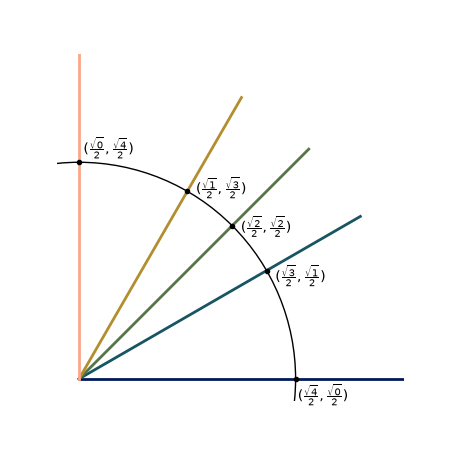

There is a [security release](https://blog.python.org/2026/10/python-3151-3149-31317/) for python.  Please update `pip`/`uv` before we begin.
### `matplotlib.pyplot`
Today's goal is to get familiar with `matplotlib.pyplot` basics.  
[`matplolib`](https://matplotlib.org/) is a common library used to generate graphics for papers and such.  Mostly I just hear people using `pyplot`.  Let's begin by using `pip` or something else to install `matplotlib`
```sh
pip install matplotlib
uv add matplotlib
```
The usual way of importing:
```python
import matplotlib.pyplot as plt
import numpy as np # ofc we will need him too
```
### figure? axes? axis?
Plotting can get confusing because there are [figures, artists, axes(s), axis(es), etc...](https://matplotlib.org/stable/users/explain/axes/axes_intro.html)

TL;DR
- Figure:
the white background
- Axes:
these are the grids data is plot on
- Axis:
the guys from elementary school
- Artists:
???

Here is a simple plot:
```python
fig, ax = plt.subplots(figsize=(l,w)) # it says subplot, but you're just making a single Axes to plot everything on
x = np.linspace( 0 , 2*np.pi , 30 ) #makes 30 points between 0 and 2pi
y = np.sin(x) # calculates sin at these points
ax.plot(x,y) # draws a line between each point, also try ax.scatter()
plt.savefig("/path/to/save/figure") # if you don't wanna save each time, maybe plt.show() will work for you (it didn't for me)
```
### Back to Pre-Calc
Your challenge today is to make a unit circle.  Here is mine: 



It doesn't have to be 1/4 of a circle, it can look however you want!
Some helpful syntax maybe:
```python
ax.set_aspect(1) # makes the circle, circular
ax.set_xlim([left_side, right_side]) # sets the bounds of axis
ax.annotate(r'$you can type basic latex using this format$', xy=[x,y], xytext=[z,t])#adding labels to point x,y and the label sits at location z,t
# there are also formatting/color options for lines and points
```
### part two: multiple plots
Sometimes we want to plot multiple plots on a single figure.
```python
fig, axs = plt.subplots(ncols=n, nrows=m)# makes multiple Axes(s) in the figure
# this is powerful because we can loop through all axes
```
Exercise: Plot 10 sine waves of increasing(or decreasing) period in 10 separate plots.
### part two-a: better organization
The next step is using `matplotlib.gridspec` to create plots of different sizes and control margins.  Here's an [example](https://matplotlib.org/stable/gallery/subplots_axes_and_figures/gridspec_multicolumn.html).
### part *, color maps
Some of the default colors are ugly and [misleading](https://www.nature.com/articles/s41467-020-19160-7).  Currently my favorite is batlow from this [package](https://www.fabiocrameri.ch/colourmaps/).
```python
from cmcrameri import cm # imports colormaps from paper
dcmap = cm.batlow(np.linspace(0,1,6)) # this is how I discretize and get 'nicer' colors
```